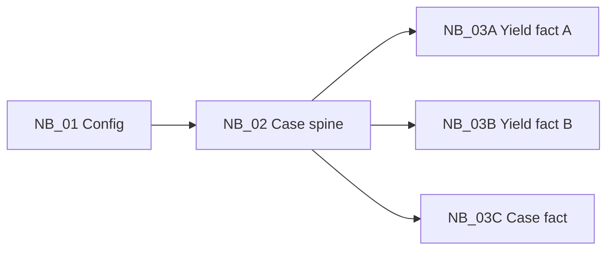

# CS2 · Surgical cases and yield pipeline refactor

**Roles:** Data Analyst · Analytics Engineer · Fabric / Data Engineer
**Stack:** Epic Caboodle (dimensional warehouse) · PySpark on Microsoft Fabric · Delta

> Anonymized case study. It contains no patient data, real table contents or employer code.

## Situation
Three surgical outputs fed the reports: case detail, appointment-based yield and a second yield view. Each notebook repeated the same cleaning of the surgical case fact table, and a source view they depended on was missing. Every run reloaded 6 years of history.

## Action
1. **Rebuilt the missing source view** from dimensional tables: surgical case fact, plus provider, patient and department dimensions.
2. **Derived case type from four rule flags** (location, primary service, primary procedure, base patient class), not one column. This means the dimension joins happen *before* the filter.
3. **Split the work into a shared spine plus three fact notebooks.** All four read a single config notebook and run as a dependency-aware DAG, so the three facts build in parallel once the spine finishes.

4. **Incremental strategy.** The 6-year lookback runs only on the initial load. Later runs reprocess a recent window and MERGE (see [`incremental_merge.py`](../../shared/fabric_utils/incremental_merge.py) and [`run_dag.py`](../../shared/fabric_utils/run_dag.py)).

## Result
- Shared cleaning logic: `[fill in: 3 copies → 1]`
- Capacity units or runtime per scheduled run: `[fill in: before → after]`

## What I learned
Refactoring a pipeline is mostly about *where* filters happen. A filter that depends on joined attributes has to come after the joins, and I prove the order is right by reconciling counts at each step.
