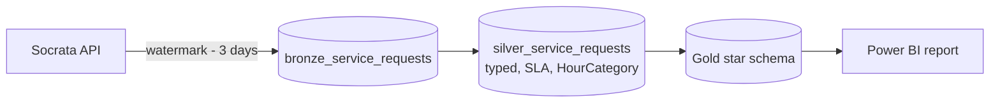

# P2 · NYC 311 service performance

**Roles:** Power BI Developer · Data Analyst · Analytics Engineer · Fabric / Data Engineer
**Stack:** PySpark + Delta (Microsoft Fabric or local Spark) · Power BI (field parameters, calculation group, time intelligence)
**Data:** [NYC 311 Service Requests from 2020 to Present](https://data.cityofnewyork.us/d/erm2-nwe9) (public; no personally identifying information)

**Live report:** `[link]` · **Demo GIF:** `[docs/assets/p2.gif]`

## Why this project
It's the public twin of my contact-center work ([CS1](../../case-studies/01-contact-center-kpi-model/)): the same incremental loads, business-hours classification, SLA metrics and metric/date-grain switching, all on open data.

## Business questions
1. Which agencies and complaint types miss their SLA most, and is it getting better or worse year over year?
2. How much demand arrives outside business hours, by borough?
3. How does median time to close vary by complaint type?

## Architecture


| Notebook | Does |
|---|---|
| [`01_bronze_ingest.py`](notebooks/01_bronze_ingest.py) | Paged API pull from the last watermark minus a lookback, then MERGE on `unique_key` |
| [`02_silver_transform.py`](notebooks/02_silver_transform.py) | Types columns, flags negative durations, assigns SLA by complaint type, builds a date dim with US holidays, adds `HourCategory` |
| [`03_gold_model.py`](notebooks/03_gold_model.py) | Integer-keyed dimensions and the fact table |
| [`dax/measures.dax`](dax/measures.dax) | SLA %, YoY, business-day-aware averages, field parameters |

## Assumptions (stated, not hidden)
- Business hours are Mon–Fri 08:00–18:00, excluding US federal holidays. 311 itself runs 24/7; this measures demand against a typical agency day.
- SLA targets are illustrative, set per complaint type with a 120-hour default. They aren't official city SLAs.
- Rows where `closed_date` is before `created_date` are kept, but excluded from duration metrics.

## Key findings
`[fill in: 3 insights with numbers]`

## Run locally
```bash
pip install pyspark==3.5.3 delta-spark==3.2.1 requests holidays
# configure Spark with Delta (see the repo-root conftest.py for a session example)
python notebooks/01_bronze_ingest.py && python notebooks/02_silver_transform.py && python notebooks/03_gold_model.py
```
