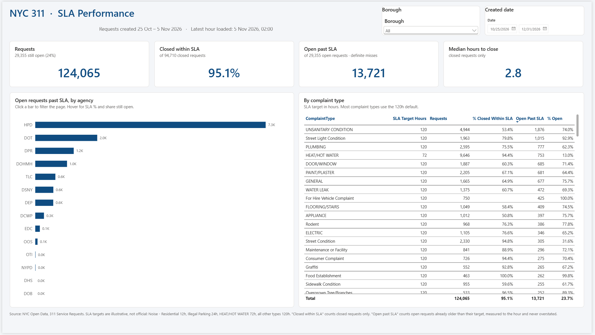
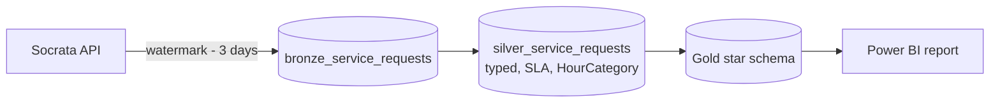

# P2 · NYC 311 service performance

**Roles:** Power BI Developer · Data Analyst · Analytics Engineer · Fabric / Data Engineer
**Stack:** PySpark + Delta (Microsoft Fabric or local Spark) · Power BI saved as a project (PBIP: TMDL model + PBIR report, all in Git)
**Data:** [NYC 311 Service Requests from 2020 to Present](https://data.cityofnewyork.us/d/erm2-nwe9) (public; no personally identifying information)

**Live report:** `[link]` · **Demo GIF:** `[docs/assets/p2.gif]`



## Why this project
It's the public twin of my contact-center work ([CS1](../../case-studies/01-contact-center-kpi-model/)): the same incremental loads, business-hours classification and SLA metrics, all on open data.

## Business questions
1. Which agencies and complaint types miss their SLA most? *(answered on the SLA Performance page)*
2. How much demand arrives outside business hours, by borough? *(planned)*
3. Is SLA performance getting better or worse year over year? *(planned: needs the multi-year backfill)*

## Architecture


| Step | Does |
|---|---|
| [`01_bronze_ingest.py`](notebooks/01_bronze_ingest.py) | Paged API pull from the last watermark minus a lookback, then MERGE on `unique_key`. Retries with backoff on 429/5xx |
| [`02_silver_transform.py`](notebooks/02_silver_transform.py) | Types columns, flags negative durations, assigns SLA by complaint type, builds a date dim with US holidays, adds `HourCategory` |
| [`03_gold_model.py`](notebooks/03_gold_model.py) | Star schema: three dimensions plus `fact_service_request`. Surrogate keys are a hash of the name (`xxhash64`), so they stay the same on every rebuild |
| [`04_export_for_powerbi.py`](notebooks/04_export_for_powerbi.py) | Local only: one Parquet file per Gold table for Power BI Desktop. In Fabric the report reads the Lakehouse directly |
| [`powerbi/`](powerbi/) | The Power BI project. Measures: [`_Measure.tmdl`](powerbi/PBI_NYC311.SemanticModel/definition/tables/_Measure.tmdl). Theme: [`NYC311.json`](powerbi/PBI_NYC311.Report/StaticResources/RegisteredResources/NYC311.json) |
| [`dax/planned_measures.dax`](dax/planned_measures.dax) | Measures drafted for later pages (YoY, after-hours share, field parameters), not yet in the model |

## Measuring SLA honestly
About 24% of requests in the test window are still open, and slow requests are exactly the ones that stay open. An SLA rate over closed requests alone therefore looks better than reality, and the newest days look best of all. The report keeps the closed-only rate but labels it as such, and shows next to it how many open requests are **already past their target**:

- **% Closed Within SLA:** closed requests with a valid close time that closed within their target.
- **Open Past SLA:** open requests whose age is already over their target. Age is measured from the latest created hour in the data, not from today's clock (the timestamps are NYC local time), and is rounded so that it is never overstated: a request only counts when it is definitely late.

## Key findings
*From the test window: requests created 25 Oct – 5 Nov 2026 (124,065 requests). These will be re-checked after the multi-year backfill.*

1. **Counting only closed requests hides most of the misses.** 4,624 closed requests missed their SLA, but 13,721 open requests are already past theirs, about 3 times as many. Counting those as misses would drop the SLA rate from **95.1% to 83.1%**.
2. **HPD (housing) accounts for 53% of all open requests past SLA**, and it isn't because of its stricter heat target. HEAT/HOT WATER (72h) is actually HPD's best category at 94.4% within SLA. The misses come from repair complaints on the regular 120h target, led by UNSANITARY CONDITION at 53.4%.
3. **NYPD handles 46% of all requests**, including every complaint type with a 12h or 24h target, and still closes **98.3%** within SLA with only 5 open past target.

## Assumptions (stated, not hidden)
- **SLA targets are illustrative, not official city SLAs:** Noise – Residential 12h, Illegal Parking 24h, HEAT/HOT WATER 72h, every other type 120h.
- **Business hours** are Mon–Fri 08:00–18:00, excluding US federal holidays. 311 itself runs 24/7; this measures demand against a typical agency day.
- **Close before create:** rows where `closed_date` is before `created_date` (94 in the test window) are kept, but excluded from duration and SLA metrics.
- **Timestamps** are NYC local time stored as-is and never converted between time zones.

## Run locally
```bash
pip install -r requirements.txt          # from the repo root
export NYC_APP_TOKEN=...                 # optional, free: avoids API rate limits
python projects/p2-nyc311-service-performance/notebooks/01_bronze_ingest.py
python projects/p2-nyc311-service-performance/notebooks/02_silver_transform.py
python projects/p2-nyc311-service-performance/notebooks/03_gold_model.py
python projects/p2-nyc311-service-performance/notebooks/04_export_for_powerbi.py   # -> pbi_export/
```

**Open the report:** in Power BI Desktop, open [`powerbi/PBI_NYC311.pbip`](powerbi/PBI_NYC311.pbip). Then go to Transform data → **Edit parameters** and set `DataFolder` to the folder that holds the Parquet files (with a trailing `\`), and click **Refresh**.
