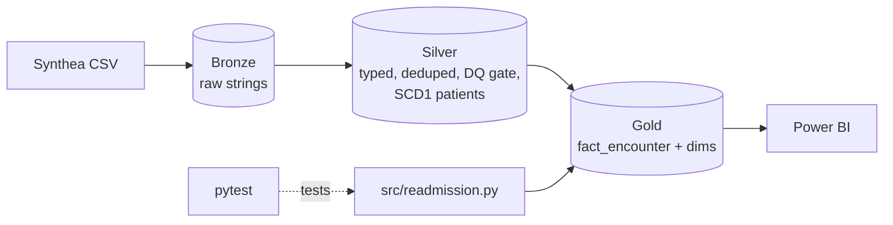

# P3 · Synthetic patient medallion lakehouse (Synthea)

**Roles:** Analytics Engineer · Fabric / Data Engineer
**Stack:** PySpark · Delta · Microsoft Fabric (or local Spark) · pytest · Power BI
**Data:** [Synthea](https://synthetichealth.github.io/synthea/) synthetic patients. Every record is generated, so no real PHI is involved.

## Why this project
It shows how I model clinical data, applying dimensional warehouse habits from my day job, without touching real patient data.

## Architecture


| Step | File |
|---|---|
| Bronze landing | [`notebooks/01_bronze.py`](notebooks/01_bronze.py) |
| Silver typing, data-quality gate, SCD1 patient dim | [`notebooks/02_silver.py`](notebooks/02_silver.py) |
| Gold fact with 30-day readmission and length of stay | [`notebooks/03_gold.py`](notebooks/03_gold.py) |
| Readmission logic, unit-tested | [`src/readmission.py`](src/readmission.py) · [`tests/`](tests/) |
| Measures | [`dax/measures.dax`](dax/measures.dax) |

## Readmission definition
An inpatient stay counts as an *index* when the same patient's next inpatient admission starts 0–30 days after discharge. Overlapping stays (likely transfers) are flagged, not counted. Planned readmissions are not excluded, so this is a simplified, all-cause measure.

## Tests
```bash
pip install pyspark==3.5.3 pytest
python -m pytest -q tests     # 5 tests: 30-day boundary, overlap, missing discharge, patient isolation, LOS
```

## Key findings
`[fill in]`
